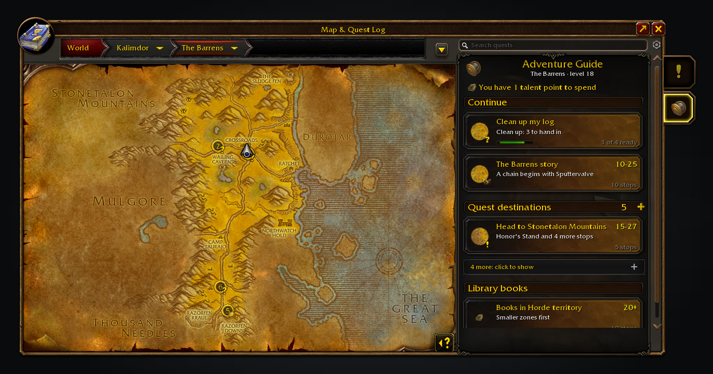
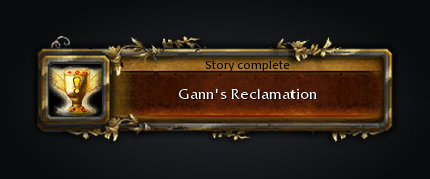
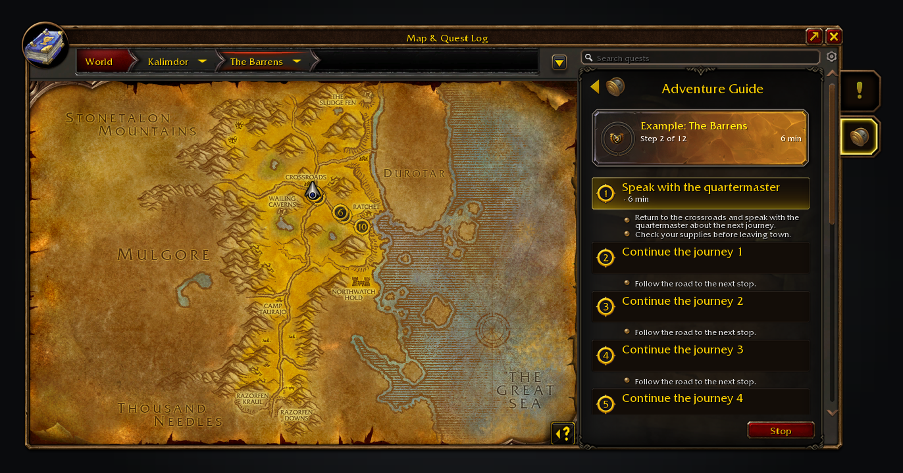
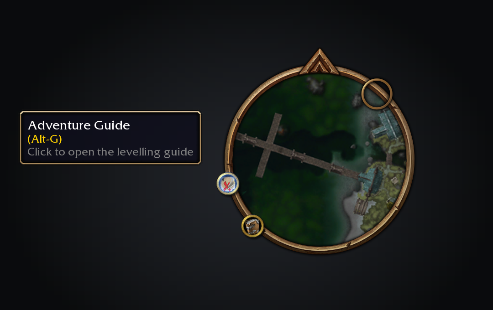

<h1 align="center">Adventure Guide Forever</h1>

Zone stories, journeys and a route walked for you in WoW: Forever

Adventure Guide Forever turns levelling into the zone's story: chapters you finish, journeys you pick on the map, dungeons with their quests and prerequisites, and a route walked for you to the next hand-in. 

   

Each zone's quests read as chapters, the map offers journeys worth taking, and Shortest Path Forever walks you from stop to stop: a pickup, an objective or a hand-in, with flights and boats included. Without it, the game's own waypoint marks the next stop.

Questie draws the quest markers; the guide adds route rings. With RestedXP installed, a one-time prompt lets you keep its display or follow its guides in Adventure Guide.

The Barrens story chosen: the card names the chapter, every stop is numbered, and Shortest Path's route runs from the first.

A journey across the sea: Shortest Path lists the boat and the flight, and the guide names the quests waiting at the far end.

The tracker names the next stop while the minimap carries the same walk.

## Features

- **Zone stories.** Each zone's quest chains read as chapters, such as *Chapter 3 of 7*, on the journey card, the map and the tracker, without naming later quests. Finishing a story shows a short popup, once per character, then moves on to the next zone for your level.
- **Journeys.** Pick a journey on the map: follow a zone's story, find nearby zones for your level, take class quests or tidy your log. Each journey explains why it fits.
- **Library books.** A Library books journey gathers the books in your faction's territory and the contested zones, then ends at the librarian who takes them.
- **Play together.** Tick party members who run the guide under *Sync with*, and the route plans the quests any of you still needs. Each stop says who it is for.
- **Dungeons.** Read a dungeon's quests and prerequisites, then visit its givers as a numbered route. Right-click a dungeon card for [AtlasLoot Classic Forever](https://www.curseforge.com/wow/addons/atlasloot-forever) bosses, drops and item tooltips.
- **A route walked for you.** Choose a journey and Shortest Path Forever takes each stop in order, on foot, by flight or by boat, with its minutes on the card. Its tracker sits above Shortest Path's directions.
- **Quests in your log.** Finishes what you already carry so the log empties instead of growing. Ready hand-ins come first, and towns group their givers into checklists.
- **Where to do objectives.** A camp with mobs 3 or more levels above you gives way to a lower one. *Next spot* in the step's menu moves the arrow to another camp, even where you stand.
- **Search.** Search puts the best match first and shows which requirements you meet. For a locked quest it names the earliest quest in its chain you can take, and a shift-click adds that one.
- **Your say.** Skip a step until your next reload, hide a journey or rule out a quest. Shift-click a search result or map quest giver to add quests. The guide never abandons quests for you. Map marks are off by default.
- **RestedXP guides.** Choose a guide from the Continue cards and follow its steps on the map and tracker. RestedXP handles completion; Shortest Path Forever handles travel.

Choose a journey from the world map's quest log. Expand a header for more choices.

Choose a journey and follow its route, checking off its quests as you go.

Finished stories are recorded once for this character.

Follow a RestedXP guide in the Adventure tab, with its engine handling progress.

Right-click a dungeon card for its bosses and loot. Hover a drop for the game's item tooltip.

## Minimap button

Open Adventure Guide from its button on the minimap rim, Alt-G or <code>/agf</code>. Drag the button around the rim to move it, or turn it off in Settings > AddOns > Adventure Guide if you prefer the map tab or the addon compartment.

## Install

Install from [CurseForge](https://www.curseforge.com/wow/addons/adventure-guide-forever) or [Wago Addons](https://addons.wago.io/addons/adventure-guide-forever), or download the zip from [Releases](https://github.com/cjber/adventure-guide-forever/releases). To install the zip by hand, extract it into the WoW: Forever client's `Interface/AddOns/` folder (`_forever_` on the live client, `_classic_beta_` on the beta), so you end up with `AddOns/AdventureGuideForever/AdventureGuideForever.toc`. After an update, `/reload`.

## Usage

| Command | What it does |
|---|---|
| `/agf`, `/adventureguide` | Open the guide on the world map |
| `/agf report` | Show a report to copy into a bug report: versions, your current stop and why, recent errors |
| `/agf issue` | Open a ready-made GitHub issue link to report a bug or request a feature |
| `/agf where` | Show the stop the guide is on, for a wrong-stop report |
| `/agf travel` | Print guidance state for a travel report |
| `/agf timing` | Print where the login's wait went, for a slow-login report |
| `/agf tracker` | Print the tracker anchors for an overlap report |
| `/agf audit` | Compare the quest data with the game and report its source |
| `/agf dump` | Save the drawn layout; `/reload`, then attach `SavedVariables/AdventureGuideForever.lua` |

Open the guide from its world-map tab, its minimap button or the addon compartment. The guide's cog holds journey filters, map marks and skipped suggestions. Other options live under Settings > AddOns > Adventure Guide, including tracking route quests and detaching the shared Forever tracker. Its Forever addons page lists all five Forever addons, with a box to turn off suggestions.

## Where the quests come from

The installed Forever edition of QuestieDB supplies quests and locations. Questie checks pickup availability; the game supplies finished quests and objective progress. Missing QuestieDB is shown explicitly.

Forever's new quests are only considered once they are in your log. The guide recommends only quests whose eligibility it can establish and never invents a location. This is not a complete levelling walkthrough.

## Works alongside

QuestieDB and Questie are needed for pickup recommendations. [AtlasLoot Classic Forever](https://www.curseforge.com/wow/addons/atlasloot-forever) is an optional companion for bosses and loot. While Polestar has a guide running, the guide starts no route and draws no map marks until you click its tracker line; *Step aside while Polestar is guiding* turns that off. The guide's tracker section shares one column with the other Forever sections, above your quests. With [Pawn](https://www.curseforge.com/wow/addons/pawn) installed, the guide leaves reward upgrade arrows to Pawn.

<!-- forever-family:start -->

## The Forever addons

Each one works on its own, and they work together when you install more than one.

| Addon | What it does | Issues |
|---|---|---|
| [Shortest Path Forever](https://www.curseforge.com/wow/addons/shortest-path-forever) | Plans journeys on foot, by air, by sea and through portals, with directions in the tracker. | [Issues](https://github.com/cjber/shortest-path-forever/issues) |
| [Adventure Guide Forever](https://www.curseforge.com/wow/addons/adventure-guide-forever) | Suggests quests for your level and routes you from one to the next. | [Issues](https://github.com/cjber/adventure-guide-forever/issues) |
| [SkillUp Forever](https://www.curseforge.com/wow/addons/skillup-forever) | Shows skill-up chances, recipe costs and levelling routes in the Professions window. | [Issues](https://github.com/cjber/skillup-forever/issues) |
| [Legacy Forever](https://www.curseforge.com/wow/addons/legacy-forever) | Shows your unfinished Legacy challenges on the world map and tracks the ones you choose. | [Issues](https://github.com/cjber/legacy-forever/issues) |
| [Tweaks Forever](https://www.curseforge.com/wow/addons/tweaks-forever) | Adds quest automation, rare alerts and merchant options to the game's settings. | [Issues](https://github.com/cjber/tweaks-forever/issues) |
| [Field Guide Forever](https://www.curseforge.com/wow/addons/field-guide-forever) | Keeps a cosmetic journal of the creatures you kill, zone by zone. | [Issues](https://github.com/cjber/field-guide-forever/issues) |
| [Commissions Forever](https://www.curseforge.com/wow/addons/commissions-forever) | Lists your commission turn-ins, the materials in your bags and the next NPC to visit. | [Issues](https://github.com/cjber/commissions-forever/issues) |
| [Macro Assist Forever](https://www.curseforge.com/wow/addons/macro-assist-forever) | Adds a macro window with every macro in one list, a mono editor with live checks, and history. | [Issues](https://github.com/cjber/macro-assist-forever/issues) |

Bug reports, feature requests and pull requests are welcome on each addon's GitHub. Everyone whose report or idea ships is thanked by name on the Thanks page in game, in the store page and in the changelog, unless they ask not to be.

For help, ideas and each day's release notes, join [cjber's Workshop on Discord](https://discord.gg/FpHugGxRJY).

<!-- forever-family:end -->

Installed together, Shortest Path Forever plans the way to every stop, SkillUp Forever fills the Professions tab, and Legacy Forever adds your zone completion. Tweaks Forever supplies class trainer locations and dungeon entrances, and its Windows option moves the guide window. Without Shortest Path Forever, Waypoint UI's arrow and pin steer to each stop instead.

## Ways to help

No code needed:

- **Wrong stop:** paste `/agf where` into a [Wrong stop issue](https://github.com/cjber/adventure-guide-forever/issues/new?template=wrong_stop.yml).
- **An error:** paste `/agf report` into a [bug report](https://github.com/cjber/adventure-guide-forever/issues/new?template=bug_report.yml).
- **A translation:** it's machine translated into German, French, Spanish, Brazilian Portuguese, Russian, Korean and Chinese; send corrections through the [translation form](https://github.com/cjber/adventure-guide-forever/issues/new?template=translation.yml).

## Development

Run the full gate in [AGENTS.md](AGENTS.md#commands). `python3 tools/doctor.py` lists the tools it needs, with a fix for each problem. Screenshots use Pillow and the [shared renderer in forever-core](https://github.com/cjber/forever-core): set `FOREVER_CORE` to the forever-core checkout and run `python3 tools/screenshots.py` twice; both runs must match. [tests/README.md](tests/README.md) describes the test layers. Contributing and security policies are inherited from [cjber/.github](https://github.com/cjber/.github).

## Support

The addon is free and stays GPL-3.0. If it saves you time, you can [sponsor me on GitHub](https://github.com/sponsors/cjber), which takes no fees, or [buy me a coffee on Ko-fi](https://ko-fi.com/cjber); nothing is locked behind it.

## Credits

Data comes from [wago.tools](https://wago.tools), [CMaNGOS classic-db](https://github.com/cmangos/classic-db) (GPL-3.0) and [Warcraft Wiki](https://warcraft.wiki.gg/wiki/Zones_by_level_(original)). Some features were inspired by [Polestar](https://github.com/fitzforge/polestar) by Fitz; no code was copied. Fitz is welcome to use our code.

<!-- forever-credits:start -->

Thanks to InfamousMunky, starkovsky, sampconrad, VinzNL, fuguer-ai, rhednak, jechten, Gnatz_0815, CodeHoax, eliasbusato, wfournier, methabolic, kragmars, Naburiel, vladsnz, jixxor, lanprite, iPulse, MrOxiMoron and everyone who reported a bug or asked for a feature.

<!-- forever-credits:end -->

## Licence

GPL-3.0-or-later; [THIRD_PARTY.md](THIRD_PARTY.md) lists inputs. No Questie or Wowhead data is bundled.

Made by Cillian Berragan · [cillian.dev](https://cillian.dev) · [GitHub](https://github.com/cjber) · [Twitter](https://twitter.com/cjberragan)

Built with AI assistance.
