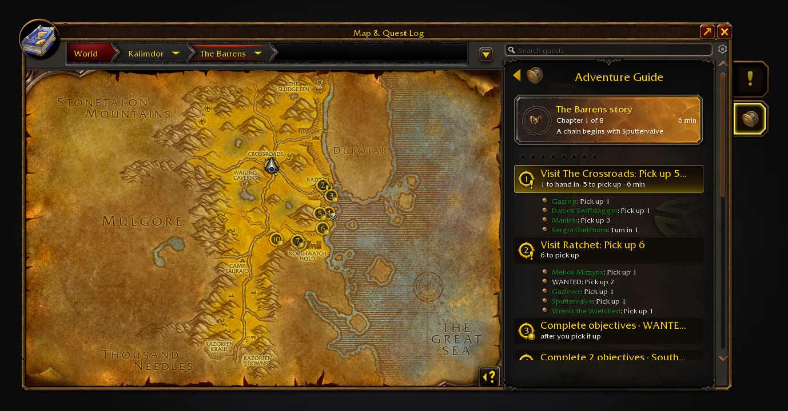
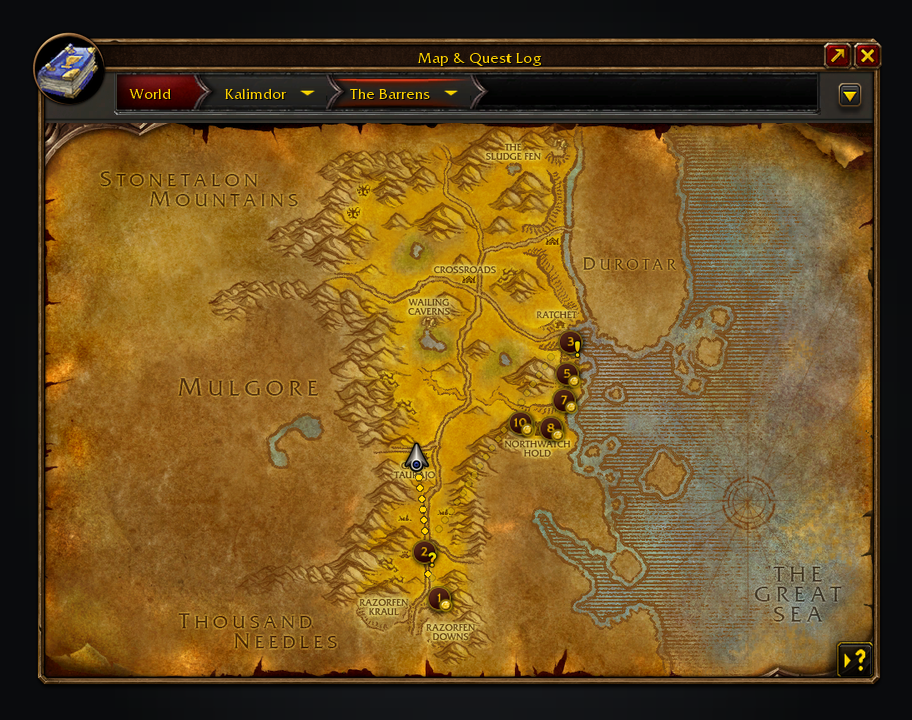
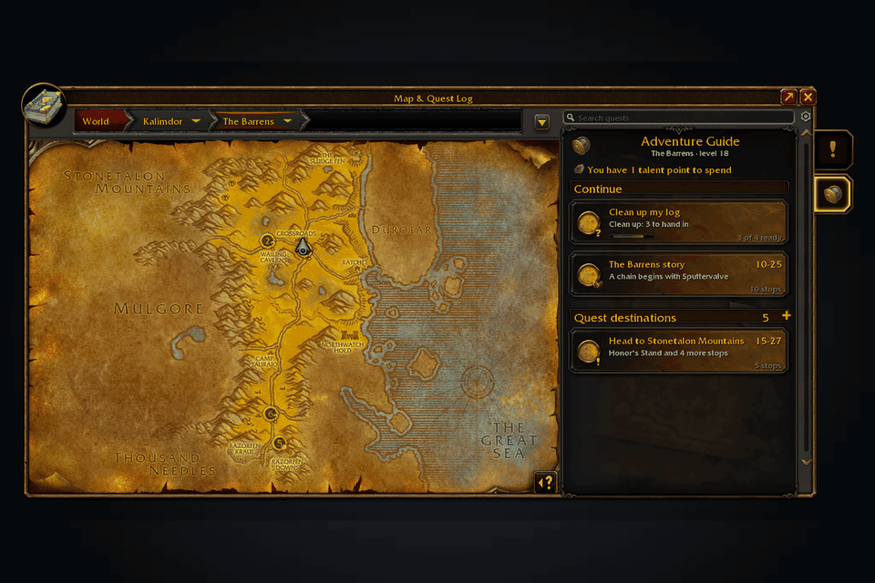
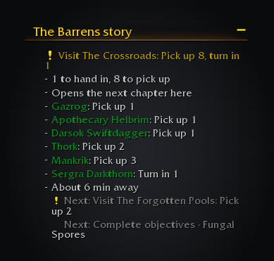
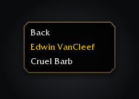

<h1 align="center">Adventure Guide Forever</h1>

Story levelling and quest routes for WoW: Forever

Levels you through zone stories and tidies your quest log, then routes you from stop to stop. 

Adventure Guide Forever is a levelling guide for WoW: Forever. Zone story journeys read as chapters, with your progress through each chapter kept per character, and **Quests in your log** finishes what you already carry so the log empties instead of growing. Then a short route joins the rest of your level's quests, and Shortest Path Forever walks you to each stop; without it, the game's waypoint does.

Questie draws the quest markers; the guide adds route rings. With RestedXP installed, a one-time prompt lets you keep its display or follow its guides in Adventure Guide.

A zone story journey, read as chapters: every stop numbered and the route drawn from the first.

Each number is a stop on the route: a pickup, an objective or a hand-in.

Choose a journey and follow its route, checking off its quests as you go.

Choose a journey from the world map's quest log. Expand a header for more choices.

Finished stories are recorded once for this character.

Follow a RestedXP guide in the Adventure tab, with its engine handling progress.

## Features

- **Zone stories.** Each zone's quest chains read as chapters, such as *Chapter 3 of 7*, on the journey card, the map guide and the tracker, without naming later quests. Finishing a story shows a short popup, once per character. Finishing a zone moves on to the next zone for your level, and starts walking there when it was guiding you.

- **RestedXP guides.** Choose a guide from the Continue cards and follow its steps on the map and tracker. RestedXP handles completion; Shortest Path Forever handles travel. While you follow one, the tracker lists only the quests its steps name, and your own tracked quests come back when you stop. While it steers a RestedXP guide, Adventure Guide shows its own item and target buttons for the current step. Turn off *Use RestedXP guides* to return to Adventure Guide's suggestions.

- **Quest difficulty.** Choose the highest recommended quest level relative to yours in Route settings. The default, +2, avoids orange and red pickups. Accepted quests remain visible.

- **Dungeon journeys.** Follow quest pickups, preparation chains and hand-ins with Shortest Path Forever. Right-click a dungeon card for AtlasLoot bosses, drops and native item tooltips. Tweaks Forever handles automatic dungeon maps.
- **Journeys.** Finish loose ends, follow a zone's story, find nearby zones suited to your level or take class quests. Journey choices explain why each fits. Dungeon and battleground journeys are opt-in.
- **Full guide.** Expand the map guide for the whole route, then the area's Questie outline. Later entries stay as outline until Questie confirms them.
- **Choose and go.** Pick a journey on the map to start guidance with Shortest Path Forever, or the game's waypoint. A setting makes choosing preview only. Stop clears only guidance the addon started.
- **A route that stays with you.** Your choice survives new quests, travel and reloads. Ready hand-ins and nearby pickups come first. Town stops group quest givers into a checklist.
- **Playing in a party.** Quests someone in your party also has count as a little nearer, so you tend to do them together, and a pickup a party member already has says so. Party members with the guide tell each other which quests they have through hidden addon messages, at most one every 15 seconds and never in combat. Turn off *Favour quests your party has* in Route settings to stop it.
- **Your order.** Drag steps or right-click to move them earlier or later. Moves that break quest order are greyed out. *Back to suggested order* restores the plan.
- **Where to do an objective.** The guide skips a place whose mobs are 3 or more levels above you for a lower one on the same map. *Next spot* in the step's menu moves the arrow to the nearest other camp, even where you stand.
- **Quest givers stand out.** While a step talks to an NPC, a pair of small arrows bounces either side of their nameplate and a target button selects them and, when you play solo, stars them if they carry no mark of their own. Friendly nameplates must be on; the tracker says so once.
- **Givers that don't offer a quest.** If a giver doesn't offer the quest the guide sent you for, the guide says so once in chat and drops it, trying again after a level-up or a hand-in that could open it up.
- **Reward upgrades.** When a quest offers rewards to choose from, the game's green arrow marks each one that beats what you wear: your armour type, a main stat your class uses and a higher item level.
- **Search.** Search puts the best match first and shows which of a quest's requirements you meet. For a locked quest it names the earliest quest in its chain you can take, and a shift-click adds that one.
- **Other things to do.** Hints cover professions, unspent talents, hearths and new lands Forever added. Class spell reminders and trainer visits are off by default (Route settings). PvP shows your rank, its next reward and the nearest battlemaster.
- **Your say.** Skip a step until your next reload, hide a journey or rule out a quest on this character. Shift-click a search result or map quest giver to add quests. *Skipped* restores hidden suggestions. The guide never abandons quests for you. Map marks are off by default.

Your next stop sits beside your quests, with travel time when Shortest Path Forever has an estimate.

Right-click a dungeon card for its bosses and loot. Hover a drop for the game's item tooltip.

## Minimap button

Open Adventure Guide from its button on the minimap rim, Alt-G or <code>/agf</code>.

Drag the button around the rim to move it. Turn it off in Settings > AddOns > Adventure Guide if you prefer the map tab or the addon compartment.

## Install

Install from [CurseForge](https://www.curseforge.com/wow/addons/adventure-guide-forever) or [Wago Addons](https://addons.wago.io/addons/adventure-guide-forever), or download the zip from [Releases](https://github.com/cjber/adventure-guide-forever/releases) and extract it into the WoW: Forever client's `Interface/AddOns/` folder (`_forever_` on the live client, `_classic_beta_` on the beta), so you end up with `AddOns/AdventureGuideForever/AdventureGuideForever.toc`. After an update, `/reload`.

## Usage

| Command | What it does |
|---|---|
| `/agf`, `/adventureguide` | Open the guide on the world map |
| `/agf report` | Show a report to copy into a bug report: versions, your current stop and why, recent errors |
| `/agf issue` | Open a ready-made GitHub issue link to report a bug or request a feature |
| `/agf where` | Show the stop the guide is on, for a wrong-stop report |
| `/agf travel` | Print guidance state for a travel report |
| `/agf timing` | Print where the login's wait went, for a slow-login report |
| `/agf tracker` | Print the tracker anchors for an overlap report |
| `/agf audit` | Compare the quest data with the game and report its source |
| `/agf leaderboard` | Rank your quest turn-ins against guild and group members who report theirs (also `/agf stats`) |
| `/agf share on\|off` | Turn sharing of your quest turn-in total with guild and groups on or off |
| `/agf dump` | Save the drawn layout; `/reload`, then attach `SavedVariables/AdventureGuideForever.lua` |

Open the guide from its world-map tab, its minimap button or the addon compartment. The guide's cog holds journey filters, map marks and skipped suggestions. Other options live under Settings > AddOns > Adventure Guide, including tracking route quests, detaching the shared Forever tracker and *Share activity with guild and groups*, the switch behind the leaderboard. Its Forever addons page lists all five Forever addons, with a box to turn off suggestions.

## Where the quests come from

The installed Forever edition of QuestieDB supplies quests and locations. Questie checks pickup availability; the game supplies finished quests and objective progress. Missing QuestieDB is shown explicitly.

Forever's new quests are only considered once they are in your log. The guide recommends only quests whose eligibility it can establish and never invents a location. This is not a complete levelling walkthrough.

## Works alongside

QuestieDB and Questie are needed for pickup recommendations. [AtlasLoot Classic Forever](https://www.curseforge.com/wow/addons/atlasloot-forever) is an optional companion for bosses and loot. While Polestar has a guide running, the guide starts no route and draws no map marks until you click its tracker line; *Step aside while Polestar is guiding* turns that off. The guide's tracker section shares one column with the other Forever sections, above your quests, and has its own switch when you prefer another guide. An empty column leaves your quests where Edit Mode or your UI addon put them. With [Pawn](https://www.curseforge.com/wow/addons/pawn) installed, the guide draws no reward upgrade arrows and leaves them to Pawn, which weighs every stat.

<!-- forever-family:start -->

## The Forever addons

Each one works on its own, and they work together when you install more than one.

| Addon | What it does | Issues |
|---|---|---|
| [Shortest Path Forever](https://www.curseforge.com/wow/addons/shortest-path-forever) | Plans journeys on foot, by air, by sea and through portals, with directions in the tracker. | [Issues](https://github.com/cjber/shortest-path-forever/issues) |
| [Adventure Guide Forever](https://www.curseforge.com/wow/addons/adventure-guide-forever) | Suggests quests for your level and routes you from one to the next. | [Issues](https://github.com/cjber/adventure-guide-forever/issues) |
| [SkillUp Forever](https://www.curseforge.com/wow/addons/skillup-forever) | Shows skill-up chances, recipe costs and levelling routes in the Professions window. | [Issues](https://github.com/cjber/skillup-forever/issues) |
| [Legacy Forever](https://www.curseforge.com/wow/addons/legacy-forever) | Shows your unfinished Legacy challenges on the world map and tracks the ones you choose. | [Issues](https://github.com/cjber/legacy-forever/issues) |
| [Tweaks Forever](https://www.curseforge.com/wow/addons/tweaks-forever) | Adds quest automation, rare alerts and merchant options to the game's settings. | [Issues](https://github.com/cjber/tweaks-forever/issues) |

Bug reports, feature requests and pull requests are welcome on each addon's GitHub. Everyone whose report or idea ships is thanked by name in the addon's credits and changelog.

<!-- forever-family:end -->

Installed together, Shortest Path Forever plans the way to every stop, SkillUp Forever fills the Professions tab, and Legacy Forever adds your zone completion. Tweaks Forever supplies class trainer locations and dungeon entrances, and its Windows option moves the guide window.

## Ways to help

No code needed:

- **Wrong stop:** paste `/agf where` into a [Wrong stop issue](https://github.com/cjber/adventure-guide-forever/issues/new?template=wrong_stop.yml).
- **An error:** paste `/agf report` into a [bug report](https://github.com/cjber/adventure-guide-forever/issues/new?template=bug_report.yml).
- **A translation:** it's machine translated into German, French, Spanish, Brazilian Portuguese, Russian, Korean and Chinese; send corrections through the [translation form](https://github.com/cjber/adventure-guide-forever/issues/new?template=translation.yml).

## Development

Run the full gate in [AGENTS.md](AGENTS.md#commands). `python3 tools/doctor.py` lists the tools it needs, with a fix for each problem.

Screenshots use Pillow and the [shared renderer in forever-core](https://github.com/cjber/forever-core): set `FOREVER_CORE` to the forever-core checkout and run `python3 tools/screenshots.py` twice; both runs must match.

[tests/README.md](tests/README.md) describes the test layers and the harness. Contributing and security policies are inherited from [cjber/.github](https://github.com/cjber/.github). Read [AGENTS.md](AGENTS.md) before changing code.

## Support

The addon is free and stays GPL-3.0. If it saves you time, you can [buy me a coffee on Ko-fi](https://ko-fi.com/cjber); nothing is locked behind it and there is no paid version.

## Credits

Data comes from [wago.tools](https://wago.tools), [CMaNGOS classic-db](https://github.com/cmangos/classic-db) (GPL-3.0) and [Warcraft Wiki](https://warcraft.wiki.gg/wiki/Zones_by_level_(original)). Some features were inspired by [Polestar](https://github.com/fitzforge/polestar) by Fitz; no code was copied. Fitz is welcome to use our code. Thanks to rhednak, deathmvp1, berserkerlxl and everyone in [THIRD_PARTY.md](THIRD_PARTY.md).

## Licence

GPL-3.0-or-later; [THIRD_PARTY.md](THIRD_PARTY.md) lists inputs. No Questie or Wowhead data is bundled.

Made by Cillian Berragan · [cillian.dev](https://cillian.dev) · [GitHub](https://github.com/cjber) · [Twitter](https://twitter.com/cjberragan)

Built with AI assistance.
