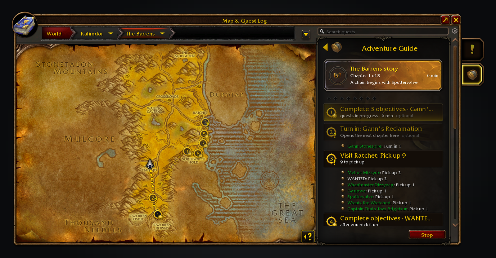
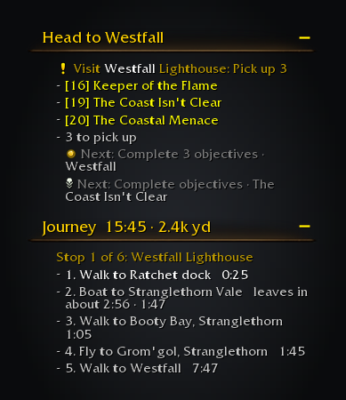
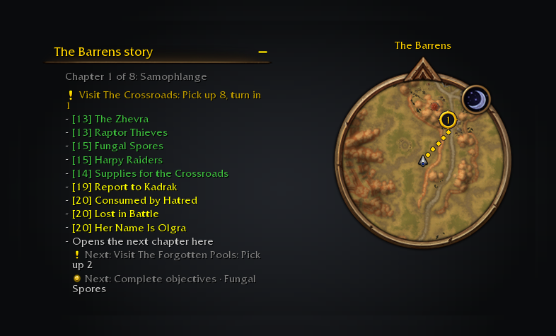
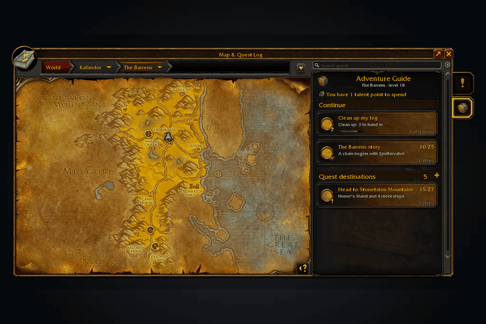
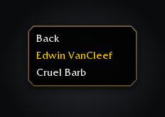

Adventure Guide Forever is an adventure companion for WoW: Forever. Each zone's quests read as chapters, the map offers journeys worth taking, and Shortest Path Forever walks you to each stop: a pickup, an objective or a hand-in, with the flight or boat in between. Dungeons come with their quests and what each asks first.

QuestieDB supplies the quests; Questie checks pickup availability. With RestedXP installed, a one-time prompt lets you keep its display or follow its guides here.

Free, with nothing locked behind it. If it saves you time, you can [buy me a coffee on Ko-fi](https://ko-fi.com/cjber).

The Barrens story chosen: the card names the chapter, every stop is numbered, and Shortest Path's route runs from the first.

A journey across the sea: Shortest Path lists the boat and the flight, and the guide names the quests waiting at the far end.

The tracker names the next stop while the minimap carries the same walk.

Choose a journey and follow its route, checking off its quests as you go.

Right-click a dungeon card for AtlasLoot bosses and drops, with native item tooltips.

These images are generated previews of the guide UI.

## Features

- **Zone stories.** Each zone's quest chains read as chapters, such as *Chapter 3 of 7*, on the journey card, the map and the tracker, without naming later quests. Finishing a story shows a short popup, once per character, and moves on to the next zone.
- **Journeys.** Pick a journey on the map: follow a zone's story, find nearby zones for your level, take class quests or tidy your log. Each journey explains why it fits.
- **Dungeons.** Read a dungeon's quests and prerequisites, then visit its givers as a numbered route. [AtlasLoot Classic Forever](https://www.curseforge.com/wow/addons/atlasloot-forever) supplies bosses, drops and native item tooltips.
- **A route walked for you.** Choose a journey and Shortest Path Forever takes each stop in order, on foot, by flight or by boat, with its minutes on the card. Without it, the game's waypoint marks the next stop.
- **Your route.** Ready hand-ins come first, towns group their givers into checklists, and a quest missing from its giver's list drops off with a line in chat.
- **Where to do objectives.** A camp with mobs 3 or more levels above you gives way to a lower one. *Next spot* moves the arrow to another camp, even where you stand.
- **Search.** Search puts the best match first, with each quest's requirements and, for a locked one, the first quest in its chain you can take.
- **Your say.** Drag steps or use their menu; moves that break quest order are greyed out. Skip a step, hide a journey or rule out a quest. The guide never abandons quests for you. Map marks are off by default.

Forever's new quests are only considered once they are in your log, and a missing location stays missing. This is not a complete levelling walkthrough.

## Usage

/agf, `/adventureguide`, the minimap button or the addon compartment opens the guide on the world map. Options are in the guide's cog and Settings > AddOns > Adventure Guide, whose Forever addons page lists all five Forever addons.
`/agf leaderboard` opens Forever Leaderboards on the Adventure Guide tab, ranking your quest turn-ins against the totals your guild and group members running the addon report; their numbers are player-reported, not verified. Sharing is on unless you turn it off with `/agf share off`, the window's Share my progress box, or the checkbox under Settings > AddOns > Adventure Guide.

For a bug report, paste `/agf report`. For a wrong stop, `/agf where`; for a missing quest, add `/agf audit`. `/agf issue` opens a ready-made GitHub issue link.

Translated into German, French, Spanish, Brazilian Portuguese, Russian, Korean and Chinese (machine translated; corrections welcome through the [translation form](https://github.com/cjber/adventure-guide-forever/issues/new?template=translation.yml)).

<!-- forever-family:start -->

## The Forever addons

Each one works on its own, and they work together when you install more than one.

| Addon | What it does | Issues |
|---|---|---|
| [Shortest Path Forever](https://www.curseforge.com/wow/addons/shortest-path-forever) | Plans journeys on foot, by air, by sea and through portals, with directions in the tracker. | [Issues](https://github.com/cjber/shortest-path-forever/issues) |
| [Adventure Guide Forever](https://www.curseforge.com/wow/addons/adventure-guide-forever) | Suggests quests for your level and routes you from one to the next. | [Issues](https://github.com/cjber/adventure-guide-forever/issues) |
| [SkillUp Forever](https://www.curseforge.com/wow/addons/skillup-forever) | Shows skill-up chances, recipe costs and levelling routes in the Professions window. | [Issues](https://github.com/cjber/skillup-forever/issues) |
| [Legacy Forever](https://www.curseforge.com/wow/addons/legacy-forever) | Shows your unfinished Legacy challenges on the world map and tracks the ones you choose. | [Issues](https://github.com/cjber/legacy-forever/issues) |
| [Tweaks Forever](https://www.curseforge.com/wow/addons/tweaks-forever) | Adds quest automation, rare alerts and merchant options to the game's settings. | [Issues](https://github.com/cjber/tweaks-forever/issues) |
| [Field Guide Forever](https://www.curseforge.com/wow/addons/field-guide-forever) | Keeps a cosmetic journal of the creatures you kill, zone by zone. | [Issues](https://github.com/cjber/field-guide-forever/issues) |

Bug reports, feature requests and pull requests are welcome on each addon's GitHub. Everyone whose report or idea ships is thanked by name in the addon's credits and changelog.

For help, ideas and each day's release notes, join [cjber's Workshop on Discord](https://discord.gg/FpHugGxRJY).

<!-- forever-family:end -->

Installed together, Shortest Path Forever plans the way to every stop. SkillUp Forever fills the Professions tab, Legacy Forever adds your zone completion, and Tweaks Forever supplies trainer locations, dungeon entrances and the window controls. Without Shortest Path Forever, Waypoint UI's arrow and pin steer to each stop instead.

Source code and issues: [github.com/cjber/adventure-guide-forever](https://github.com/cjber/adventure-guide-forever). Licence: GPL-3.0-or-later.

Built with AI assistance.
